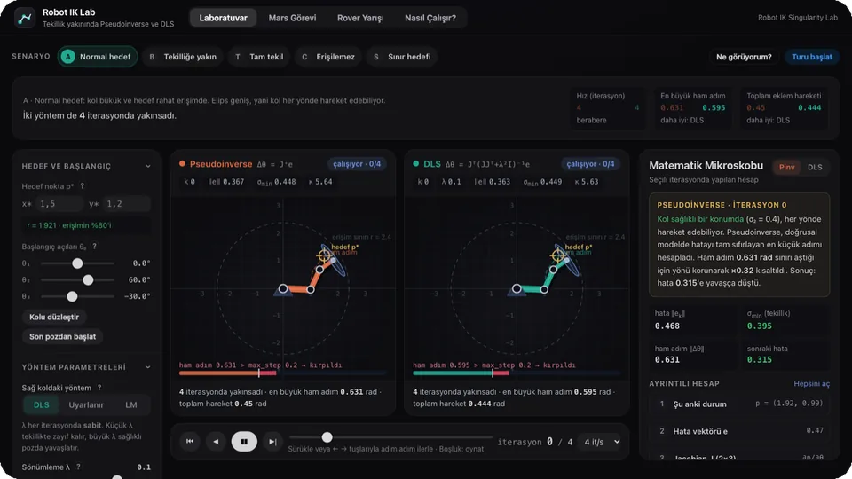
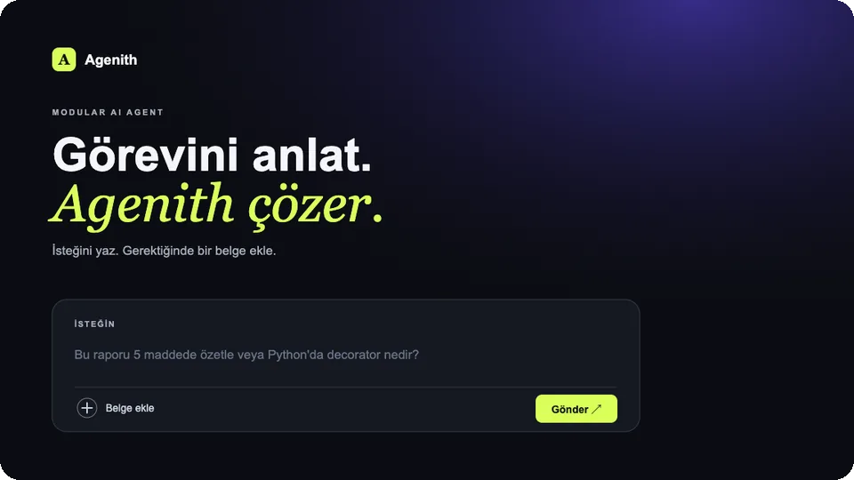
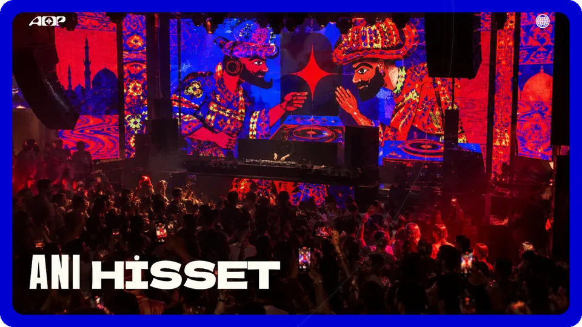
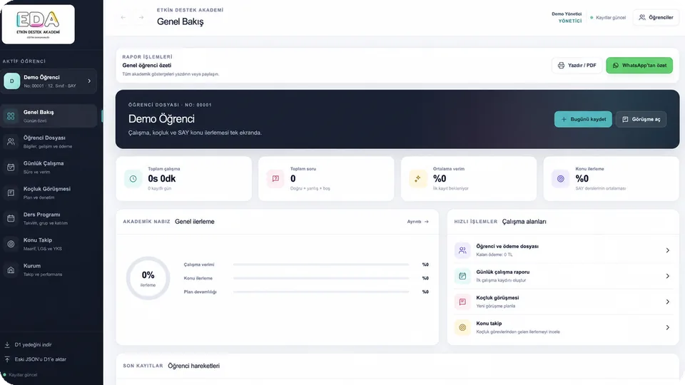
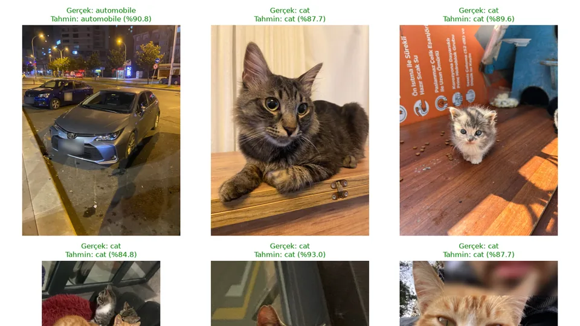
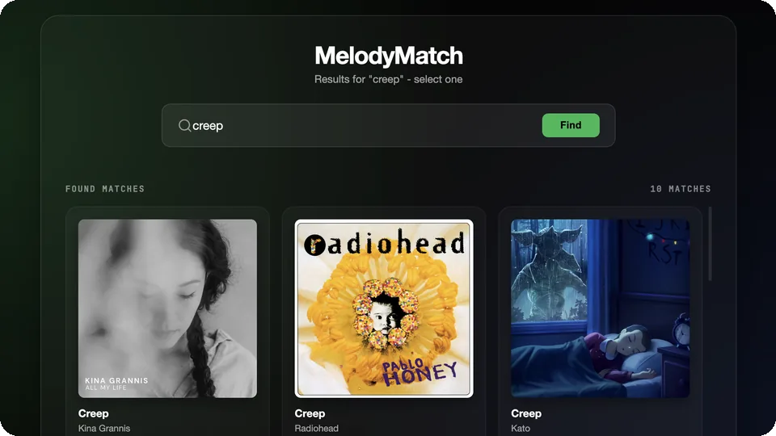

<div align="center">


**AI Engineer @ Peranet · Computer Engineering @ Istanbul Medeniyet University**

I build **AI that actually ships** — enterprise agents, MCP integrations and retrieval pipelines —
and I go all the way down the stack to **C, Linux kernels, FPGAs and autonomous robots**.

<a href="https://www.linkedin.com/in/ahmet-yusuf-bursal-03324321b/"></a> <a href="https://bursal0.github.io/robot-ik-singularity-lab/"></a> <a href="https://aopcreativeagency.com/"></a>

</div>

---

## ⚡ What I do

```yaml
ai_engineering:   [LLM agents, multi-agent orchestration, tool routing, MCP servers, RAG, reranking]
enterprise_ai:    [Google Agentspace, Vertex AI, Gemini, OpenAI GPT, Anthropic Claude, MCP servers, company-specific agents, CRM automation]
voice_ai:         [AI phone agents, conversational voice bots, ElevenLabs speech synthesis, real-time dialogue]
machine_learning: [PyTorch, JAX (vmap/jit on GPU), transfer learning, CNNs, gradient boosting, model serving]
full_stack:       [FastAPI, Flask, TypeScript, Cloudflare Workers/D1/R2, serverless, motion-heavy web]
systems:          [C, POSIX processes & IPC, shells, Linux kernel modules]
hardware:         [FPGA digital design, Raspberry Pi, embedded C, rovers, drones, autonomous navigation]
robotics_math:    [inverse kinematics, SVD, damped least squares, Levenberg–Marquardt, convergence analysis]
```

## 🏢 Experience

### 💼 AI & CRM Engineer — **Peranet**
*Enterprise AI · Voice AI · CRM platforms · Google Cloud · OpenAI · Anthropic Claude*

- 🤖 **Enterprise agentic AI on Google Agentspace** — architected and shipped **company-specific AI agents** for client organisations, grounded in each company's internal knowledge, documents and workflows
- 🔌 **Model Context Protocol (MCP) servers** — engineered custom MCP integrations that expose proprietary tools, data sources and business operations to agents through a standard, secure interface
- ☁️ **Google Vertex AI** — built generative-AI pipelines: prompt engineering, embeddings, batch prediction and multimodal inference on Gemini models
- 📞 **AI voice & phone agents** — built conversational phone bots that hold natural, real-time calls: **OpenAI GPT** models for dialogue and reasoning, **ElevenLabs** for lifelike speech synthesis
- 🧠 **Claude-based systems** — designed and integrated LLM solutions on Anthropic's Claude for production business use cases
- 🧩 **CRM & help-desk engineering** — developed, customised and automated CRM / service-desk platforms: workflow automation, data integration and AI-assisted customer operations

### 🛰️ Hardware, Robotics & Autonomy
- 🚗 **Autonomous rover** — end-to-end autonomy stack on Raspberry Pi: perception, decision-making and closed-loop motor control
- 🔲 **FPGA digital design** — hardware description, synthesis and on-board implementation of digital systems
- 🚁 **Rovers & UAVs** — built, integrated and programmed ground rovers and drones
- 🦾 **Robot kinematics research** — numerically stable IK near singularities, being prepared for real rover manipulators

### 📊 Data Science
- Extensive portfolio of notebooks and competition entries on **Kaggle** — feature engineering, gradient boosting and deep learning

---

## 🌟 Showcase

<table>
<tr>
<td width="50%" valign="top">
<a href="https://github.com/bursal0/robot-ik-singularity-lab"></a>
<h3><a href="https://github.com/bursal0/robot-ik-singularity-lab">🦾 Robot IK Singularity Lab</a></h3>
<p>Numerically stable inverse kinematics near kinematic singularities — convergence proofs, adaptive SV &amp; Levenberg–Marquardt damping, paired-bootstrap statistics and an interactive rover simulator. Next stop: real rovers.</p>
<p><code>JAX</code> <code>GPU</code> <code>NumPy</code> <code>JavaScript</code></p>
<p>⭐ <b>320k GPU solves · 508× faster than NumPy · 1026/1026 cross-validated</b> · <a href="https://bursal0.github.io/robot-ik-singularity-lab/">live ↗</a></p>
</td>
<td width="50%" valign="top">
<a href="https://github.com/bursal0/agenith-agent"></a>
<h3><a href="https://github.com/bursal0/agenith-agent">🧠 Agenith — Modular AI Agent</a></h3>
<p>Brain → Orchestrator → Tool Registry agent architecture with LLM-driven tool selection, retrieval-grounded PDF QA over FAISS and map-reduce whole-document reasoning.</p>
<p><code>Python</code> <code>FastAPI</code> <code>Gemini</code> <code>FAISS</code></p>
<p>⭐ <b>Pluggable tools · grounded answers · quota-free test suite</b></p>
</td>
</tr>
<tr>
<td width="50%" valign="top">
<a href="https://github.com/bursal0/aop-agency-website-case-study"></a>
<h3><a href="https://github.com/bursal0/aop-agency-website-case-study">🎨 AOP Creative Agency</a></h3>
<p>High-fidelity, scroll-driven motion website for an Istanbul creative &amp; events agency — animated brand intro, cinematic hero film, fail-closed edge-authenticated preview pipeline.</p>
<p><code>JavaScript</code> <code>CSS</code> <code>Netlify Edge</code> <code>Cloudflare</code></p>
<p>⭐ <b>In production</b>  · <a href="https://aopcreativeagency.com/">aopcreativeagency.com ↗</a></p>
</td>
<td width="50%" valign="top">
<a href="https://github.com/bursal0/eda-akademik-takip-case-study"></a>
<h3><a href="https://github.com/bursal0/eda-akademik-takip-case-study">🎓 EDA Akademik Takip</a></h3>
<p>Production education-operations platform: student files, coaching, scheduling, analytics and finance — with server-side authorisation, audit trails and verifiable backups.</p>
<p><code>TypeScript</code> <code>React</code> <code>Workers</code> <code>D1</code> <code>R2</code></p>
<p>⭐ <b>Running in production behind Cloudflare Access</b></p>
</td>
</tr>
<tr>
<td width="50%" valign="top">
<a href="https://github.com/bursal0/cifar10-resnet18-classification"></a>
<h3><a href="https://github.com/bursal0/cifar10-resnet18-classification">🖼️ CIFAR-10 · ResNet18</a></h3>
<p>ImageNet-pretrained ResNet18 fine-tuned by transfer learning, with failure-case analysis and out-of-distribution evaluation on real smartphone photos, served through Gradio.</p>
<p><code>PyTorch</code> <code>torchvision</code> <code>Gradio</code></p>
<p>⭐ <b>95.03 % test accuracy · macro-F1 95.02 % · ~6.8 ms / image</b></p>
</td>
<td width="50%" valign="top">
<a href="https://github.com/bursal0/SongRecommendation"></a>
<h3><a href="https://github.com/bursal0/SongRecommendation">🎧 MelodyMatch</a></h3>
<p>Content-based music recommender over a 9-dimensional audio-feature space — standardised cosine similarity with a genre prior and real-time autocomplete search.</p>
<p><code>Python</code> <code>scikit-learn</code> <code>FastAPI</code></p>
<p>⭐ <b>Deployed full-stack</b> · <a href="https://songrecommendation-production.up.railway.app/">live ↗</a></p>
</td>
</tr>
</table>

## 🧩 More projects

<table>
<tr>
<td width="50%" valign="top">

#### 🔎 Retrieval & Machine Learning
- **[rag-pdf-chatbot](https://github.com/bursal0/rag-pdf-chatbot)** — hybrid RAG: dense (FAISS + sentence embeddings) + sparse (BM25) retrieval, score fusion, LLM cross-reranking and source-attributed answers
- **[house-price-api](https://github.com/bursal0/house-price-api)** — XGBoost regression with log-target transform and an end-to-end sklearn pipeline behind a REST API
- **[mnist-mlp-handwritten-digit-recognition](https://github.com/bursal0/mnist-mlp-handwritten-digit-recognition)** — controlled ablation of MLP capacity and learning rate; domain-shift test on my own handwriting

</td>
<td width="50%" valign="top">

#### ⚙️ Systems Programming (C / POSIX)
- **[drone-swarm-choreographer](https://github.com/bursal0/drone-swarm-choreographer)** — a 184-drone light show run by cooperating processes over FIFOs, **lock-free shared memory** (seqlock) and recordings: beat clock, per-beat collision and speed audits, watchdog with standby takeover, SDL2 viewer
- **[air-gapped-agency](https://github.com/bursal0/air-gapped-agency)** — fault-tolerant multi-agent orchestration without networking: fork/exec supervision, `FD_CLOEXEC` handshakes, atomic publishing, file-mailbox IPC, crash recovery
- **[mining-robot](https://github.com/bursal0/mining-robot)** — autonomous exploration with BFS and **risk-weighted Dijkstra** planning, function-pointer policies, SDL2 renderer
- **[mini-shell](https://github.com/bursal0/mini-shell)** — Unix job-control shell with background processes, per-task logs and status tracking

</td>
</tr>
</table>

---

## 🔒 Private & NDA work

<sub>Source code belongs to employers and clients, so it is not public. What I built is described below.</sub>

<table>
<tr>
<td width="50%" valign="top">

#### 🏗️ CRM → AI data platform for Google Agentspace · *Peranet*
An enterprise data platform that turns a company's CRM and help desk into **permission-aware knowledge** for AI agents.

- **Zoho CRM connector:** 12 modules (Leads, Accounts, Contacts, Deals, Quotes, Products, Purchase Orders, Contracts, Campaigns, Tasks, Events, Calls) pulled through the **Bulk Read API v8**: async export jobs, polling, streamed ZIP/CSV ingestion in 1 MB chunks
- **Zoho Desk connector:** accounts, contacts, tickets, tasks, contracts, products and agents, plus **nested ticket threads, conversations and comments** fetched in parallel by an 8-worker `ThreadPoolExecutor`, with rate-limit-aware retries
- **Schema-driven modelling:** a 600+ field inventory and master schema, with every record split into domain **stores**:
  - CRM: identity · contact · sales pipeline · marketing & ad attribution · activity · product · finance
  - Desk: identity · ticket lifecycle · conversation · operations
- **Customer analytics:** RFM features (recency · frequency · monetary) alongside each account
- **Warehouse:** lands in **Cloud Storage + BigQuery** with auto-provisioned tables and **content-hash (MD5) record IDs** for idempotent re-runs
- **Security:** a **document-level ACL** on every record, so Agentspace answers each employee only from data they are allowed to see

</td>
<td width="50%" valign="top">

#### 🤖 Company-specific agents & MCP servers · *Peranet*
- **Google Agentspace agents** for client companies, grounded on the warehouse above, so sales and support teams can query customers, deals and tickets in natural language
- **MCP servers** exposing CRM, help-desk and internal business operations to agents through the **Model Context Protocol**, as typed tools with controlled access
- **Claude-based systems** for production business workflows

#### ☁️ Generative AI on Vertex AI · *Peranet*
- Gemini **text generation, code generation and multimodal (image) inference**
- **Batch prediction** jobs and **batch embedding** pipelines (JSONL in, JSONL out) for large-scale processing
- **Text-embedding** pipelines for semantic search and retrieval
- Systematic **prompt engineering** and evaluation

#### 📞 AI phone & voice agents · *Peranet*
- **Conversational phone bots** that answer and run real calls end to end, with no human in the loop
- **OpenAI GPT** for intent understanding, dialogue management and response generation
- **ElevenLabs** voices that turn every reply into natural-sounding speech
- Tuned for spoken conversation: short turns, quick responses and a consistent voice persona

</td>
</tr>
<tr>
<td width="50%" valign="top">

#### 🛰️ Robotics & hardware
- **Raspberry Pi autonomous rover:** self-driving stack covering sensing, decision logic and closed-loop motor control
- **FPGA digital design:** HDL modules, synthesis and on-board implementation
- **Drones & rovers:** building, integration and programming

</td>
<td width="50%" valign="top">

#### 🐧 Low-level systems *(in progress / coursework)*
- **[Autonomous drone-swarm choreography](https://github.com/bursal0/drone-swarm-choreographer):** independent processes that coordinate a show over a common channel API across **FIFOs, shared memory and files**, later **TCP/UDP across machines**, with per-beat collision and speed safety audits and a live SDL2 viewer
- **Linux kernel modules:** a thread monitor exposed through `/proc` and a kernel-space drone simulation

</td>
</tr>
</table>

---

## 🛠️ Toolbox

<div align="center">


<br><br>


</div>

## 🤝 Let's build something

<div align="center">

Open to **AI engineering, agentic systems and robotics** roles, research collaborations and ambitious side projects.

<a href="https://www.linkedin.com/in/ahmet-yusuf-bursal-03324321b/"></a>

<sub>Always building something — from prompts to processors.</sub>

</div>
